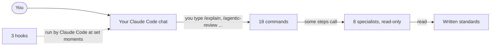

# Olympus AI Coding Harness

A set of specialist reviewers, step-by-step commands and safety checks for
[Claude Code](https://code.claude.com/docs), Anthropic's coding assistant, packaged as one plugin.
Built by Khan.

## Contents

- [What is it?](#what-is-it)
- [Who is it for?](#who-is-it-for)
- [What is in the box?](#what-is-in-the-box)
- [How do I install it?](#how-do-i-install-it)
- [What should I try in my first hour?](#what-should-i-try-in-my-first-hour)
- [What stops it doing damage?](#what-stops-it-doing-damage)
- [What has been measured, and what has not?](#what-has-been-measured-and-what-has-not)
- [What are its limits?](#what-are-its-limits)
- [Credits and licence](#credits-and-licence)
- [Under the hood](#under-the-hood)

## What is it?

**What you see.** You open a chat in Claude Code and work the way you normally would. The
difference shows at the moments that matter. Ask for a review, and several specialists read your
change separately and hand back one verdict. Ask how some code works, and the answer starts with
what you would experience and ends with the technical detail. End the session, and the notes the
next session needs are already written.

**What it actually is.** Not a program you run. It is a folder of plain text files that Claude
Code reads: instructions for eight specialists, eighteen commands you start by typing a slash, a
set of written engineering standards, and three small scripts that run by themselves at set
moments. Claude Code loads the folder as one unit, called a **plugin**.

A **harness** is the word for this kind of setup: the rig around a capable model that makes it
behave the same careful way every time. A climbing harness does not make you a better climber, but
it stops the fall. Olympus does not make Claude smarter. It makes it more careful, consistently.

**Why it exists.** One assistant asked to write code and then check that code is marking its own
homework. Olympus splits the jobs. The assistant that builds is not the one that reviews. The
reviewers hold no tool for editing your files. And for changes where a mistake would be expensive,
a second layer tries to disprove what the reviewers claimed before anything is allowed to block
you.

## Who is it for?

People who already use Claude Code and want a second, independent reader on their changes,
especially people who are still learning and cannot always tell a sound change from a plausible
one. Every explanation it produces is written for a smart reader with no assumed background.

It is probably not for you if you want a ready-made app, if you do not use Claude Code, or if you
are not on Windows and do not want to be the first to try it elsewhere (see
[What are its limits?](#what-are-its-limits)).

## What is in the box?



Your chat is the only part that edits files, runs commands or asks you anything. Everything else
hands it written notes.

| Piece | What it is | Examples |
|---|---|---|
| Specialists | Assistants with one job each, which Claude Code calls **agents**. Each works in its own separate conversation, so a reviewer is not anchored to the assumptions of whoever wrote the code | A code reviewer, a security reviewer, a reviewer that hunts failures a program hides, a code explainer |
| Commands | Checklists your own chat follows when you type a slash and the name. Claude Code calls them **skills** | `/explain`, `/plan-product`, `/test-first`, `/agentic-review`, `/handover` |
| Workflows | Scripts that run many specialists at once. Expensive, so they run only when you ask for one by name | A deep review that has three more specialists try to disprove every serious finding |
| Rules | The written standards the specialists apply: code review, testing, error handling, security, and Python and JavaScript specifics | |
| Hooks | Small Python scripts Claude Code runs by itself: when a chat starts, on every message, and when a reply ends | A warning as the chat's working memory fills up; a check that changed code was reviewed before a reply ends |

Nine of the eighteen commands were written for Olympus. The other nine were written by other people
and are included under their own licences, listed in [THIRD_PARTY_NOTICES.md](THIRD_PARTY_NOTICES.md).

The full manual, with every command and specialist, is [USER_GUIDE.md](USER_GUIDE.md).

## How do I install it?

There is no installer. Installing means putting the folder on your computer and showing Claude Code
where it is. These steps are the ones tested, on Windows 11 in PowerShell, the command line that
comes with Windows.

1. **Check that you have Claude Code and Python.** The three hooks are Python scripts. Type
   `python --version`. If it prints no version number, or opens the Microsoft Store, install
   Python 3 first.

2. **Download the repository.** Copy its address from the green **Code** button at the top of
   its GitHub page, then type the following in the folder where you keep your projects:

   ```powershell
   git clone <the repository's address>
   ```

3. **Show Claude Code where the plugin is.** Claude Code looks for your own skills and plugins in
   a `skills` folder inside `.claude` in your user folder. Make a **junction** there: a folder
   entry that is really a doorway into another folder, so the files stay where you downloaded
   them and an update you pull is live at once. Put the full path of the downloaded `olympus`
   folder in place of the example:

   ```powershell
   New-Item -ItemType Directory -Force "$HOME\.claude\skills"
   ```

   ```powershell
   New-Item -ItemType Junction -Path "$HOME\.claude\skills\olympus" -Target "C:\path\to\Olympus-AI-Coding-Harness\olympus"
   ```

   On macOS or Linux the same idea is a symbolic link,
   `ln -s /path/to/Olympus-AI-Coding-Harness/olympus ~/.claude/skills/olympus`. **This has not
   been tested.**

4. **Turn on workflows.** Add `"enableWorkflows": true` to your `~/.claude/settings.json`. The two
   workflows have only ever been run with it set.

5. **Optional: let your chat pick the command for you.** `olympus/ZEUS.md` is a short playbook
   that tells your chat which command or specialist fits which kind of request, so you can talk in
   plain words. It is written as a template: read it, change it to how you work, then add this
   line to your `~/.claude/CLAUDE.md`, the file of your own working preferences that Claude Code
   reads at the start of every chat:

   ```text
   @~/.claude/skills/olympus/ZEUS.md
   ```

6. **Open a new chat and run the boundary test.** Type `/agentic-review`: it should be recognised
   as a command. Then ask `olympus:apollo-code-reviewer` to edit a file: it should decline,
   because it holds no tool that edits.

Two of the third-party commands need more. `impeccable` runs scripts with Node.js, and `graphify`
installs its own Python package from the internet the first time you type it. Three of the
third-party commands contact the internet; [SECURITY.md](SECURITY.md#what-do-the-third-party-commands-do)
lists what each one sends and how to switch it off.

## What should I try in my first hour?

| Try | What it shows you |
|---|---|
| Type `/explain` and the name of a file you have never read | The order of the answer: what you would see, then how the parts hand work to each other, then the technical detail |
| Make a small change, then type `/agentic-review` | The verdict at the top, which reviewers it chose, and why. `CLEAN` is common and is not a lazy review |
| Ask a reviewer to fix what it found | It declines, because it has no editing tool. That refusal is the design working |
| Type `/plan-product` and describe an idea loosely | A scope with explicit non-goals, which are what stop a two-day change becoming a two-week one |
| Type `/handover`, then open the `HANDOVER.md` it wrote | What the next chat will be told, so you never re-explain where you were |

The review command is `/agentic-review`, not `/review`: Claude Code has a review of its own that
answers to `/review`.

## What stops it doing damage?

Four things, each checkable rather than promised.

- **The specialists cannot edit files or run commands.** Each specialist's file starts with a
  `tools:` line, and Claude Code gives it those tools and no others. Seven hold the same three:
  read a file, search inside files, find files by name. The design reviewer holds one more, for
  loading a command's design criteria; loading one was tested and added no tool. A specialist that wants a command
  run writes it down, and your own chat runs it where you can see it. To check, read the `tools:`
  line at the top of each file in `olympus/agents/`.
- **A review fails closed.** "Fails closed" means that when something goes wrong it refuses
  rather than approves. A reviewer that could not run makes the verdict `INCOMPLETE`, never
  `CLEAN`, because a reviewer that never ran found nothing only in the sense that it looked at
  nothing.
- **The expensive machinery waits to be asked.** A workflow runs only when you ask for one by
  name. That is Claude Code's own instruction to the model, not something Olympus adds: a rule the
  model follows, not a lock.
- **The hooks fail open.** "Fails open" is the opposite choice, made deliberately here: a hook
  that breaks exits quietly, so a broken script can never stop your chat. The cost is that a
  broken hook does not tell you it stopped working.

**What it cannot stop.** The hooks are code that runs on your computer, as you, on every message.
Read them before you install, the same as any plugin. The specialists can read any file you can,
not only the project you point them at. [SECURITY.md](SECURITY.md) has the detail and how to
report a problem.

## What has been measured, and what has not?

The reviewers were tested by rebuilding old versions of real projects that contained a bug already
found and fixed, and checking whether the reviewers found it without being told. The answers were
written down and frozen before each run.

| Measured | Result |
|---|---|
| The first replay: four real bugs from an earlier project | **0 of 4 caught.** Later rounds caught some known bugs and missed others; the specialists' instructions were corrected after each miss, and a correction counts as working only once a later, separate test shows it |
| Taking the command line away from the specialists | The benchmark was re-run without it. The one bug that run turned on was still found, by reading alone, at roughly half the cost |
| What the deep review workflow costs | About 600,000 tokens for a two-file review, measured before the specialist team was reduced from thirteen to eight. A **token** is the unit models read and bill by, about three-quarters of a word |
| What the plugin adds to every message | About 2,000 tokens, estimated on 10 October 2026 from the length of the descriptions a chat loads. Claude Code's own plugin report put it at about 2,700, counting every command |

| Not measured |
|---|
| How it does on your projects, in your languages, or on anyone else's computer |
| The explore workflow, which has never been run on a real codebase |
| Any operating system other than Windows 11 |

## What are its limits?

- **Tested on Windows 11 only**, with the plugin found through the `skills` folder as in the steps
  above. Installing it through a Claude Code plugin marketplace has not been tried.
- **Built and used by one person.** The design choices reflect one way of working; `ZEUS.md` is
  where you change them.
- **The rules cover Python and JavaScript in detail.** Other languages get the general standards
  only.
- **It does not make the reviews right.** It makes them independent, consistent and honest about
  what they did not check. A `CLEAN` verdict is a second opinion, not a guarantee.

## Credits and licence

Olympus is released under the [MIT licence](LICENSE), copyright 2026 Khan.

The nine third-party commands keep their own licences and authors, listed with their sources in
[THIRD_PARTY_NOTICES.md](THIRD_PARTY_NOTICES.md): `archify` by tt-a1i, `impeccable` by Paul
Bakaus, `graphify` by Safi Shamsi and the Graphify contributors, the three `ponytail` commands by
DietrichGebert, and `animate`, `review-animations` and `pick-ui-library` by Emil Kowalski.

Olympus runs on [Claude Code](https://code.claude.com/docs) by Anthropic, and is not made or
endorsed by Anthropic.

## Under the hood

| Path | Holds |
|---|---|
| `olympus/` | The plugin itself, the only folder Claude Code needs |
| `olympus/.claude-plugin/plugin.json` | The plugin's name, `olympus`, which is why every specialist and command has `olympus:` at the front of its full name |
| `olympus/agents/` | The 8 specialists, one file each |
| `olympus/skills/` | The 18 commands, one folder each |
| `olympus/workflows/` | The two workflows |
| `olympus/rules/` | The written standards |
| `olympus/hooks/` | The three hooks, registered in `hooks.json`, plus `statusline.py`, an optional status line you switch on yourself in `~/.claude/settings.json` |
| `olympus/ZEUS.md` | The routing playbook template |
| `tests/review.logic.test.mjs` | A test of the review workflow's decision logic. Run it with `node tests/review.logic.test.mjs` |
| `build_release.py`, `test_release.py` | The script that builds this public copy from the private one and refuses on anything private, and its tests |
| [USER_GUIDE.md](USER_GUIDE.md) | The full manual |
| [SECURITY.md](SECURITY.md) | What runs on your computer, and how to report a problem |

Claude Code's documentation names saving a plugin in your skills folder as a way to use it
yourself, without a marketplace: see its [plugin documentation](https://code.claude.com/docs/en/plugins).
