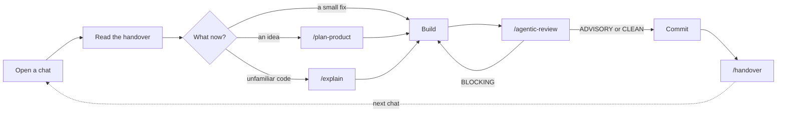
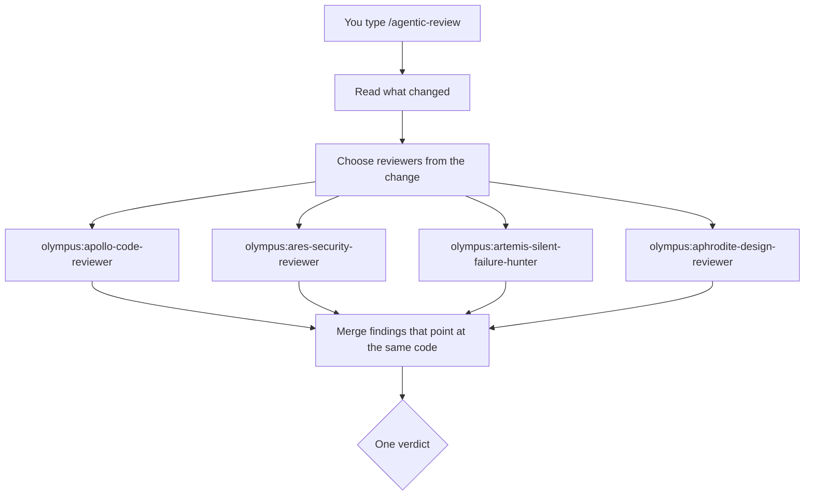
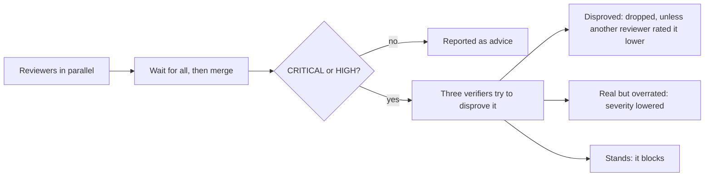

# Olympus User Guide

Edition of 10 October 2026. Written for someone using Olympus for the first time: install it, learn the everyday tasks, then read how it works when you want to know why.

**Contents**

- **Part 1: Getting started**
  - [What is Olympus?](#what-is-olympus)
  - [How do the pieces fit together?](#how-do-the-pieces-fit-together)
  - [How do I install it?](#how-do-i-install-it)
  - [What should I try in my first hour?](#what-should-i-try-in-my-first-hour)
- **Part 2: Everyday tasks**
  - [What does a working session look like?](#what-does-a-working-session-look-like)
  - [What can Olympus do for me?](#what-can-olympus-do-for-me)
  - [How do I start and end a session?](#how-do-i-start-and-end-a-session)
  - [How do I understand code I did not write?](#how-do-i-understand-code-i-did-not-write)
  - [How do I turn an idea into a plan?](#how-do-i-turn-an-idea-into-a-plan)
  - [How do I make a change safely?](#how-do-i-make-a-change-safely)
  - [How do I check a change before I commit it?](#how-do-i-check-a-change-before-i-commit-it)
  - [What else can I ask for?](#what-else-can-i-ask-for)
- **Part 3: How it works**
  - [Who is in charge?](#who-is-in-charge)
  - [Who are the eight specialists?](#who-are-the-eight-specialists)
  - [How is a command different from a specialist?](#how-is-a-command-different-from-a-specialist)
  - [Where does the system keep what it knows?](#where-does-the-system-keep-what-it-knows)
  - [How does a review decide whether my change is safe?](#how-does-a-review-decide-whether-my-change-is-safe)
  - [When is the heavy machinery worth it?](#when-is-the-heavy-machinery-worth-it)
  - [What can the specialists do to my files?](#what-can-the-specialists-do-to-my-files)
  - [How does the system learn from its mistakes?](#how-does-the-system-learn-from-its-mistakes)
- **Part 4: Reference**
  - [Which command should I type?](#which-command-should-i-type)
  - [Which specialist does what?](#which-specialist-does-what)
  - [What do the verdicts and severities mean?](#what-do-the-verdicts-and-severities-mean)
  - [Where is everything?](#where-is-everything)
  - [What does it cost?](#what-does-it-cost)
  - [What if something goes wrong?](#what-if-something-goes-wrong)
  - [Glossary](#glossary)
  - [About this guide](#about-this-guide)

## Part 1: Getting started

### What is Olympus?

**What you see.** You open a chat in Claude Code, the coding assistant, inside your projects folder, and type the way you normally would. The difference shows up at the moments that matter. Ask for a review, and several specialists read your change separately and hand back one verdict. Ask how something works, and the answer starts with what you would experience and ends with the technical detail, never the other way round. End the session, and the notes the next session needs are already written.

**What it actually is.** Olympus is not a program you run. It is a set of plain text files on your computer that Claude Code reads, in three groups:

| Group | What it is | How many |
|---|---|---|
| Specialists | Assistants with one job each, each described in a short instruction file | 8 |
| Commands | Procedures you start by typing a slash, such as `/explain` | 9 written for Olympus, plus 9 by other authors |
| Rules and records | The standards the specialists apply, and the notes each project keeps about itself | A folder of each |

All of it comes packaged as one **plugin**: a single folder that Claude Code loads as a unit. The plugin is called `olympus`, which is why every specialist and command has `olympus:` at the front of its full name. You type commands by their short name, such as `/explain`, and Claude Code finds the right one. **The review command is called `/agentic-review`, not `/review`.** Claude Code has a review of its own that answers to `/review`, and when this was tested on 12 September 2026, a bare `/review` reached that one instead, so the plugin's review was given a name nothing else uses.

A **harness** is the word for this kind of setup: the rig around a capable model that makes it behave the same careful way every time. A climbing harness does not make you a better climber, but it does stop the fall. Olympus does not make Claude smarter. It makes it more careful, consistently.

**Why it exists.** A single assistant asked to write code and then check that code is marking its own homework. Olympus splits the jobs. The assistant that builds is not the one that reviews. The reviewers hold no tool for editing your files. And for changes where a mistake would be expensive, a second layer tries to disprove what the reviewers claimed before anything is allowed to block you.

### How do the pieces fit together?

The diagram below is a map of the whole system. Read it from the left: you type to the main chat, and everything else hangs off that one conversation.

**What you deal with directly** is the left half. You type in plain words to the **main chat**, the Claude Code conversation in front of you. Before your first message it has already read your `CLAUDE.md`, a file of your working preferences. It is the only part of the system that edits your project's files, runs commands, or stops to ask you anything.

**What the main chat reaches for** is the right half, the boxed area: the `olympus` plugin. When you type a command, the main chat follows that command's steps. Some steps call **specialists**, which read your project, check it against the shared **rules**, and hand back a written note. The two **workflows** call many specialists at once, and only when you ask for one. The three **hooks** are small scripts Claude Code runs by itself at set moments: when a chat starts, on each message, and when a reply ends.

**Why the specialists sit in a "read-only" box.** None of them holds a tool that edits files or runs commands. A reviewer that could also fix would stop being an independent check and become a second author. [What can the specialists do to my files?](#what-can-the-specialists-do-to-my-files) explains the trade.

### How do I install it?

If Olympus already works on your computer, skip this section: typing `/agentic-review` in a chat would already be recognised.

There is no installer. The steps are in the [README](README.md#how-do-i-install-it), kept in one place so two copies cannot drift apart. In short: check that Python works, download the repository, show Claude Code where the `olympus` folder is, turn on workflows, optionally switch on the routing playbook, and run the boundary test.

Four things the short version leaves out:

- **Why the hooks need Python.** The three hooks are small Python scripts: the handover pointer, the context warnings, and the done gate, which checks that a changed code file was reviewed before a reply ends. They come inside the plugin, but Python has to be on the computer to run them.
- **Why a junction rather than a copy.** A **junction** is an entry in one folder that is really a doorway into another. Claude Code looks in `~\.claude\skills\`, where `~` means your user folder, walks through the doorway and finds the plugin where you downloaded it. So a change you make to the downloaded folder, or an update you pull, is live at once, with no second copy to keep in step. Nothing inside the plugin names a particular computer: it refers to its own location by a placeholder Claude Code fills in, so there are no paths to fix.
- **Your own instructions come first.** Your `~\.claude\CLAUDE.md` describes how you like to work, and Claude Code reads it at the start of every chat. `olympus\ZEUS.md`, the playbook described in [Who is in charge?](#who-is-in-charge), is written as one person's working rules and is meant to be changed: read it, adapt it to how you work, and only then add the line `@~/.claude/skills/olympus/ZEUS.md` to your `CLAUDE.md`.
- **Two of the installed commands need more than the folder.** `impeccable` runs scripts with Node.js, a program for running JavaScript outside a browser, and `graphify` installs its own Python package from the internet the first time you type it. Three of the third-party commands contact the internet; [SECURITY.md](SECURITY.md#what-do-the-third-party-commands-do) lists what each one sends and how to switch it off.

### What should I try in my first hour?

Five things, in this order. Each shows you one part of the system working.

1. **Open a chat in your projects folder.** If there is a recent handover, watch Claude read it first. That is the memory between sessions.
2. **Type `/explain` followed by a file you have never read.** Notice the order of the answer: what you would see, then how the parts hand work to each other, then the technical detail.
3. **Make a small change, then type `/agentic-review`.** Read the verdict at the top, which reviewers it chose, and why.
4. **Ask a reviewer to fix what it found**, for example "ask `olympus:apollo-code-reviewer` to apply its fix". It will decline, because it holds no editing tool. That refusal is the design working, not a fault.
5. **Type `/handover`.** Then open the project's `HANDOVER.md` and read what the next chat will be told.

After that hour, Part 2 covers each everyday task, and Parts 3 and 4 are there to look things up as you meet them.

## Part 2: Everyday tasks

### What does a working session look like?

Most sessions follow the same loop. You will not use every step every time: a one-line fix goes straight from building to reviewing.

| Step | What happens | Why it is there |
|---|---|---|
| Open a chat | If the last session left a handover note under a week old in the folder you opened, Claude is pointed at it first | So you never re-explain where you were |
| Plan | `/plan-product` turns a loose idea into a scope with explicit non-goals | Non-goals are what stop a two-day change becoming a two-week one |
| Understand | `/explain` walks through unfamiliar code from the top down | Changing code you do not understand is the most expensive habit there is |
| Build | You and Claude make the change, test first when behaviour changes | A test written before the fix proves the fix did something |
| Review | `/agentic-review` picks reviewers from what you changed and returns a verdict | A second, independent reader before the change is permanent |
| Hand over | `/handover` writes what changed and where you stopped | So the next chat starts where this one ended |

A **commit** is a saved snapshot of your project that you can return to. Reviewing before it catches problems while they are still cheap to fix.

### What can Olympus do for me?

Six things, one for each stage of a change. Read each column from the top: what you type, who does the work, and what you get back. The dashed line along the bottom is the order a change usually travels in.

The sections below take each stage in turn. You do not have to remember the commands: if your chat runs Zeus, saying "how does this work?" or "check this" picks the right one for you.

### How do I start and end a session?

**To start**, open a chat in the project's own folder. If the last session left a `HANDOVER.md` there under a week old, a hook points the new chat at it before your first message, so Claude knows where you stopped. The hook looks only in the folder the chat opened in, never in folders inside it, so a chat opened in the wrong place is not pointed at the wrong project's notes.

**While you work**, a hook warns you at 50%, 75% and 90% of the chat's working memory, called its **context window**. Picture it as a desk: everything said so far is on it, and at every step Claude re-reads the whole desk before doing the next thing. So each step costs more than the one before, and a long chat gets slower and more expensive without getting any smarter. On the computer Olympus was built on, re-reading earlier replies was measured at about 69% of a long session's spend, and one step at 900,000 tokens of context cost roughly 18 times the same step in a fresh chat. A **token** is the unit models read and bill by, about three-quarters of a word.

| Warning | Do |
|---|---|
| 50% | Finish the task in hand. Start any new subject in a new chat |
| 75% | Run `/handover` at the next clean point, then open a new chat |
| 90% | Start nothing new. Write the handover and stop |

**To end**, type `/handover`. It checks the project's records against what actually changed, updates them, and writes a short `HANDOVER.md` for the next chat. **A session ends rather than degrades.**

### How do I understand code I did not write?

Type `/explain` followed by a file, a function or an idea. `olympus:hermes-code-explainer` reads it and explains it top-down: what you would experience, then which part hands what to which, then the technical mechanism, with every term defined before it is used. At the end it offers to record what you learned.

Two related habits:

- **"Learning check"** at the end of a task explains the change just made, in four parts: what happened, why, how it helps, and what it teaches about building software. It is built from what git recorded, not from memory.
- **`/learned`** adds one entry to `LEARNING.md` once you understand something well enough to explain it to someone else.

### How do I turn an idea into a plan?

Type `/plan-product` and describe the idea loosely, the way you would to a colleague. `olympus:athena-architect` turns it into a scope, the non-goals with a reason for each, one test of when it is done, and the shape it should take with its trade-offs. Your own chat then writes the build plan.

The non-goals are the point. They are what stop a two-day change becoming a two-week one.

For any change that is not trivial, the main chat shows you a plan first, naming the files it will touch and why, and waits for you to say **go**. You approve the intent; it owns the execution.

### How do I make a change safely?

When a change alters behaviour, such as a wrong result, a boundary, a calculation, stored data or access, type `/test-first`. Your own chat runs the loop, because it is the only part that can run tests:

1. **Name what to test, and predict the failure.**
2. **Write the test and watch it fail**, for the reason predicted. A test that fails for a different reason proves nothing.
3. **Make the fix and watch the test pass**, for the right reason.

**After two failed fixes on the same fault it stops and asks you**, with options, instead of trying a third. That stop is a written rule, not a lock, so it can be missed: if a chat keeps trying, tell it to stop.

### How do I check a change before I commit it?

Type `/agentic-review`. It reads exactly the lines you changed, chooses up to four reviewers from what those lines touch, runs them in parallel, merges what they found, and returns one verdict:

| Verdict | What you do |
|---|---|
| `BLOCKING` | Fix it before committing |
| `ADVISORY` | Commit if you accept the findings, and fix them when convenient |
| `CLEAN` | Commit. This is common, and not a sign of a lazy review |
| `INCOMPLETE` | A reviewer could not run. Rerun it, and never treat this as clean |

If your question is about a whole part of the system rather than your latest change, say so: "review the publishing code, not just my diff". A review scoped to your change does not look at code you did not touch.

When being wrong would cost more than being slow, such as money, publishing or anything you cannot undo, ask for the review workflow instead. It is far more expensive; [When is the heavy machinery worth it?](#when-is-the-heavy-machinery-worth-it) explains when it earns that.

### What else can I ask for?

| You want | Type | What happens |
|---|---|---|
| To know whether something on screen looks right | `/design-check` | `olympus:aphrodite-design-reviewer` checks it against the project's own recorded design rules, not generic taste |
| A second opinion from other AI models | `/review-package` | Builds a package you send to outside reviewers yourself, then combines their answers into a ranked plan |
| To start a new project | `/new-project` | Sets up the folder in a safe order: decide what is private, keep it out of version control, prove that worked |
| To find your way round an unfamiliar codebase | Ask for the explore workflow | Four readers map it from different angles; one account comes back |
| Interface design, polish or accessibility | `impeccable` | An installed design command |
| A standalone architecture or workflow diagram | `archify` | An installed diagram command; the diagrams in this guide were made with it |

`impeccable`, `archify` and the other installed commands come from outside Olympus and are optional.

## Part 3: How it works

### Who is in charge?

**Zeus.** The specialists are named after Olympian gods, and Zeus rules over them. Zeus is not a ninth specialist. It is the role played by the chat you talk to. That chat reads a short playbook, `ZEUS.md`, which tells it which god handles which kind of request. It sends the gods out, collects their answers, and brings you one reply. Zeus sits in the main chat on purpose: a specialist works out of your sight and cannot stop to ask you anything, while the chat you talk to can.

The diagram follows one request from start to finish. Each row is one participant; read left to right.

**What you experience.** You ask in plain words. For anything that is not trivial you see a plan and say go. Then you hear from Zeus again only at the moments that are yours to decide: a commit, the expensive deep review, anything destructive or that leaves your computer, and a fault that two fixes have not cured.

**What happens in between.** Zeus picks the route from its table: a question about how something works goes to Hermes, a loose idea to Athena, a change straight to the plan. After the build, `/agentic-review` sends reviewers in, and their findings come back as one verdict. A `BLOCKING` verdict sends the work back to the build; anything else goes to you for the commit.

**What Zeus tells you as it works.** Before a decision that shapes the code, at most four sentences: what, why, the option it rejected, and what that costs. After a change, two sentences on what is now true and what proved it, then one line on what it did not check.

### Who are the eight specialists?

Think of them as colleagues in separate rooms. Each works at its own desk, meaning its own context window, reads only what its job needs, and hands back a written note. Claude Code calls them **agents**. This guide calls them specialists, because that is what they are.

Separate rooms matter for two reasons:

- **Independence.** A reviewer that did not write the code is not anchored to the assumptions of whoever did. Several reading separately catch what one reading would miss, and when two find the same problem independently, that agreement is evidence in its own right.
- **Cost.** Whatever a specialist reads stays on its desk, not yours. The written standards run to about 750 lines, and a reviewer reading the parts it needs costs your main conversation nothing. That is why the standards live in files the specialists read, rather than in the instructions your chat carries all the time.

They are arranged as the life of a change, and the order is itself a lesson: the expensive mistakes happen near the top of this list, not the bottom.

| Stage | Specialists |
|---|---|
| Understand | `olympus:hermes-code-explainer` |
| Plan | `olympus:athena-architect` |
| Build | None. The test-first loop is a command, `/test-first`, run by your own chat because it needs to run the tests |
| Review | `olympus:apollo-code-reviewer`, `olympus:ares-security-reviewer`, `olympus:artemis-silent-failure-hunter`, `olympus:aphrodite-design-reviewer` |
| Maintain | `olympus:hestia-docs-updater` |
| Evaluate | `olympus:hephaestus-agent-evaluator` |

**There were thirteen until 2026-09-25.** Five were folded into the ones above, in four measured
steps: a Python reviewer into the general one, a product planner into the architect, a blueprint
writer into your own chat's plan, a test-first coach into a command, and a simplifier into a
command. Each merge had to pass the same benchmark case the pair had scored before, and the sixth
candidate, `olympus:artemis-silent-failure-hunter`, **failed that test and stayed** — the general
reviewer could not find the two defects artemis was kept for.

Each full name has three parts: `olympus:`, the plugin it comes from; the name of an Olympian god chosen to fit the job; and the plain job title, which is the part that tells you what it does. So `olympus:apollo-code-reviewer` is the code reviewer.

**The size of model follows the job, not the importance.** Claude comes in three sizes here. `haiku` is small, fast and cheap. `sonnet` is the middle. `opus` is the largest and most careful, and costs the most. Mechanical work with a clear right answer gets `haiku`. Applying a written standard to real code gets `sonnet`. Only work where the judgement is itself the product gets `opus`: explaining well to someone without the background, for instance, is harder than checking code against a list.

**To use one, name it.** "Use `olympus:artemis-silent-failure-hunter` on the parsing changes" is the reliable way. Claude will also call a specialist on its own when your request matches that specialist's description, but naming it removes the guesswork.

**Zero findings is a valid answer.** Every reviewer is told this explicitly. A reviewer that always finds something trains you to skim, which is worse than one that sometimes says nothing.

**One timing rule.** A new or renamed specialist becomes available from your next message, without a new chat. An edited one is less predictable: an edit has been seen to reach the chat it was made in, but only once, so when it matters, open a new chat or test it with a request only the new version would answer correctly.

### How is a command different from a specialist?

A **command**, which Claude Code calls a skill, is a checklist handed to the Claude you are already talking to. It runs inside your conversation, can see everything on your desk, and can call specialists as some of its steps. `/agentic-review`, for example, is a command whose steps are: read the change, choose reviewers, run them, merge what they found, give a verdict.

A specialist is a separate colleague in a separate room. So the practical differences are:

| | Command | Specialist |
|---|---|---|
| Where it runs | Inside your conversation | In its own room, at its own desk |
| How you start it | Type `/` and its name | Name it, or let a command call it |
| When a new one works | Immediately, the moment its file exists | From your next message; an edited one may need a new chat |
| Sees your conversation | Yes | No, only what it is handed |

### Where does the system keep what it knows?

In three tiers, and the tier a file sits in tells you how far its authority reaches.

| Tier | What lives there | Read when |
|---|---|---|
| You | How you like to work, in every project, forever | At the start of every chat |
| Workspace | Which projects exist, and the standards every project shares | Every chat opened in the projects folder |
| Project | One codebase's facts, status, decisions and notes | When you work in that project |

Inside each project the notes are split across files by one rule: **each file answers one question, and goes stale at its own speed.**

| File | Answers | Goes stale |
|---|---|---|
| `CLAUDE.md` | What is permanently true of this codebase? | Rarely. Read at the start of every chat, so it is kept short |
| `STATE.md` | What is true right now? | Every working session |
| `DECISIONS.md` | What did we decide, and why? | Never. Old entries stay, so nobody reopens a settled question |
| `HANDOVER.md` | Where did the last session stop? | Within days. Replaced at every handover, and capped at 60 lines |

Picture a filing cabinet with its drawers sorted by shelf life. Mixing a fact that never changes with a status that changes daily is how both end up wrong: the status goes stale and drags the fact's credibility down with it.

Two more stores sit with the system itself, in the folder you downloaded. **The standards** live in a `rules` folder inside the plugin: code review, testing, error handling, security and more. Nobody reads them at the start of a chat; each specialist reads the rule it needs when it runs. And **`LEARNING.md`** holds concepts you have understood well enough to explain to someone else, written by `/learned`.

### How does a review decide whether my change is safe?

1. It reads your **diff**: exactly the lines you changed since the last commit.
2. It chooses reviewers from what changed. `olympus:apollo-code-reviewer` always runs, and it reads the Python rules as well when any Python file changed. `olympus:artemis-silent-failure-hunter` joins if error handling or parsing changed, `olympus:ares-security-reviewer` if the change touches file paths, commands, databases, a new dependency, or a project that might be published, and `olympus:aphrodite-design-reviewer` if anything visible changed.
3. They review in parallel, each in its own room, each applying the same written severity scale.
4. Findings that point at the same code are merged. Several reviewers describe one problem several different ways, but the code they point at stays the same, so the code is what they are matched on.
5. One verdict comes back: `BLOCKING`, `ADVISORY`, `CLEAN` or `INCOMPLETE` — or `BLOCKING` and `INCOMPLETE` together, when something serious survived *and* one of the reviewers never ran. What each means, and what to do about it, is in [What do the verdicts and severities mean?](#what-do-the-verdicts-and-severities-mean)

**Before a reviewer reports anything, it must pass four questions**, called the Pre-Report Gate. Can it cite the exact line? Can it name the input that triggers the failure? Has it read the surrounding code? Would its severity survive someone who disagrees? Any "no" lowers the severity or drops the finding.

**`INCOMPLETE` is the verdict to understand first.** A reviewer that could not run reviewed nothing, and Olympus never reads that as "found nothing". An approval you did not earn is worse than no approval at all.

### When is the heavy machinery worth it?

A **workflow** is a script that runs many specialists in a fixed order. Olympus has two, and **they only run when you ask for one by name**, because they are expensive.

**The review workflow** does what `/agentic-review` does and adds a second layer. Every serious finding, meaning `CRITICAL` or `HIGH`, goes to three fresh specialists called verifiers, whose only job is to disprove it, each from a different angle: does the code really say what the finding claims, can the failure actually be reached, and is it already handled somewhere the reviewer did not look.

Three rules decide what survives:

- **A majority that disproves a finding drops it.** One sceptic can be wrong, which is why there are three.
- **A majority can also say a finding is real but overrated,** and lower its severity instead of dropping it. A real defect that nothing can currently trigger is not an emergency.
- **Disproving one reviewer's grade never erases another's.** If one reviewer called a problem `CRITICAL`, another called the same problem `MEDIUM`, and the `CRITICAL` claim is disproved, the problem survives at `MEDIUM`.

It also **fails closed**, meaning that when something goes wrong it refuses rather than approves. A reviewer that could not run, a reviewer asked for by a name that does not exist, or a reviewer that comes back without saying which files it read, all make the result `INCOMPLETE`. A verifier that could not run leaves the finding standing.

**What it costs.** Measured twice on a two-file review: about 600,000 tokens of specialist work, spread across ten specialists. That measurement was taken before the 2026-09-25 merges, when the workflow had four review dimensions rather than three, so treat it as the right order of magnitude rather than today's exact figure. `/agentic-review` uses between one and four. Hence the rule: **use the workflow when being wrong costs more than being slow.** Publishing, money and anything you cannot undo qualify. An ordinary change does not.

**The explore workflow** is for walking into an unfamiliar codebase. Four readers map it from angles none of the others can see: where control starts, how data moves, what the tests are afraid of, and what was borrowed rather than built. One merge then turns their notes into a single account. It has not yet been run on a real codebase.

To run either, ask in plain words: "run the review workflow on the publishing code".

### What can the specialists do to my files?

Less than they could, but more than you might assume.

**None of them holds a tool for editing files.** Each specialist's file opens with a header, called its frontmatter, that lists the tools it may use, and that list cannot be talked around by a persuasive request. A reviewer that could also fix would stop being an independent check and become a second author.

**None of them can run commands either, and that is a change made on evidence.** Until 2026-09-18, eight of the then thirteen held `Bash`, a command line, on the argument that running the code to reproduce a failure is what separates a proven finding from a guess. A command line can also create, change and delete files anywhere you can. That was not hypothetical: specialists checking one review built four throwaway copies of a project in a scratch folder to test their theories, one of them after deleting a folder. They touched nothing else, but nothing in their tools stopped them.

So the tool was taken away, and the benchmark was re-run to find out what it cost. **The answer was: nothing that mattered.** The one defect the run turned on was still found, by reading alone, and the whole round cost roughly half as many tokens. The argument for the command line had sounded strong and did not survive being measured.

**What replaces it.** A specialist that needs a command now writes it down under a heading called `NEEDS_RUN`, and your own chat runs it where you can see it. The judgement stays with the specialist; the hand on the keyboard is yours. The risk did not disappear, it moved to where you can watch it.

The practical rule survives the change, for a different reason: **when the code under review matters, point the review at a copy of it.** Not because a reviewer might damage the original any more, but because your own chat still runs the commands they ask for, and because a review you can re-run against an unchanged copy is a review you can check.

**Two tests you can run yourself.** Ask a reviewer to apply its own fix: it should decline because it lacks the tool, not out of politeness. Ask it to run something: it should hand the command back under `NEEDS_RUN` rather than report an answer. If it edits a file, or claims to have run anything, its tool list is wrong.

### How does the system learn from its mistakes?

By measuring them, rather than trusting that a fix worked.

Every time a specialist is caught getting something wrong, by missing a real problem, inventing one, or grading one too harshly, it goes into a **ledger**: one row per miss, recording what went wrong, what was changed to correct it, and whether that correction has since been shown to work.

That last column is the point. **A correction nobody has tested is only an intention.** A correction made today is tested in a later chat, on a case of the same kind: nothing the chat that wrote the fix knows can help it there, and an edited specialist is not guaranteed to load in the chat that edited it.

**A worked example.** One reviewer twice rated a problem far too high when no real input could ever reach the code involved. The cause turned out to be its instructions: they asked what the user would see if the failure happened, and never asked whether it could happen. The correction added that second question. On the next run, facing the same kind of problem, it rated it correctly. That is one data point, so the ledger records it as a pass rather than a proof.

**When enough corrections are waiting to be tested, the ledger triggers a replay.** Old code containing a known, already-fixed bug is rebuilt, the reviewers look at it without being told, and how many they catch is recorded. The trigger is a count of untested corrections, not a date, because the result can only change when the instructions change. Running it on a calendar would spend a great deal to measure the same number again. `olympus:hephaestus-agent-evaluator` scores the results.

The ledger behind these examples is the maintainer's own record and is not part of this repository. To measure the specialists on your own work, keep one of your own in the same shape: what went wrong, what was changed, and whether a later test showed the change worked.

## Part 4: Reference

### Which command should I type?

| Type | It does | It runs | Reach for it when |
|---|---|---|---|
| `/plan-product` and your idea | Turns an idea into scope, non-goals with reasons, one test of done, and the shape with its trade-offs | `olympus:athena-architect`, then your own chat writes the blueprint | You can say what you want but not where it stops |
| `/test-first` and a change to behaviour | Names what to test, predicts the failure, then runs the red-green loop and checks each half happened for the right reason. After two failed fixes on the same fault it stops and asks you, with options. That stop is a written rule, not a lock, so it can be missed: if a chat keeps trying, tell it to stop | Nothing else. Your own chat runs the tests | A wrong result, a boundary, a calculation, stored data, access, or any bug fix |
| `/explain` and a file or concept | Explains top-down with no unexplained jargon, then offers to record what you learned | `olympus:hermes-code-explainer` | You do not follow some code, or are about to change it |
| "Learning check", at the end of a task | Explains the change just made, in four parts: what happened, why, how it helps, and what it teaches about building software. Built from what git recorded, not from memory. Ends by asking whether you could re-explain it | Nothing else. Your own chat writes it | You want to understand what a task changed |
| `/agentic-review` | Reviews your change and returns one verdict. Not `/review`, which reaches Claude Code's own review | One to four reviewers, chosen from what changed | Before any commit that is not trivial |
| `/design-check` | Checks an interface against the project's own recorded design rules | `olympus:aphrodite-design-reviewer`, then a design command | Anything visible changed |
| `/learned` | Adds one entry to `LEARNING.md` | Nothing else | You understood something well enough to explain it |
| `/handover` | Checks the records against the project's history, then writes status, decisions and a short note for the next chat | `olympus:hestia-docs-updater`, then offers `/learned` | Ending a session, or at the 75% warning |
| `/new-project` | Sets up a project folder in a safe order: decide what is private, keep it out of version control, prove that worked | Nothing else | Starting any new project |
| `/review-package` | Builds a package for outside AI reviewers, then combines their answers into a ranked plan | Nothing else | You want a second opinion from other models |

### Which specialist does what?

**None of them runs commands and none of them edits files.** Seven hold the same three tools:
read a file, search inside files, find files by name. That is the whole list, and it is checkable —
`grep "^tools:" olympus/agents/*.md` prints it.

| Specialist | Stage | Model | Reach for it when |
|---|---|---|---|
| `olympus:hermes-code-explainer` | Understand | opus | You do not follow a piece of code |
| `olympus:athena-architect` | Plan | opus | An idea needs scope and non-goals, or a choice would be expensive to reverse |
| `olympus:apollo-code-reviewer` | Review | sonnet | Any change that is not trivial. Reads the Python rules too when Python changed |
| `olympus:ares-security-reviewer` | Review | sonnet | Before publishing, or adding a dependency |
| `olympus:artemis-silent-failure-hunter` | Review | sonnet | Error handling, parsing, data feeds and fallbacks |
| `olympus:aphrodite-design-reviewer` | Review | sonnet | Any template, stylesheet or component change |
| `olympus:hestia-docs-updater` | Maintain | haiku | After a batch of commits, or before a handover |
| `olympus:hephaestus-agent-evaluator` | Evaluate | sonnet | A review felt noisy or thin, or you are measuring the reviewers |

The one exception to "the same three tools" is `olympus:aphrodite-design-reviewer`, which may also
load one command, `impeccable`, to borrow its design criteria. Loading a command does not add a tool:
on 10 October 2026 the design reviewer loaded `impeccable` and its tool list stayed exactly the same.

### What do the verdicts and severities mean?

**Verdicts**, the outcome of a review:

| Verdict | Means | What you do |
|---|---|---|
| `BLOCKING` | A `CRITICAL` or `HIGH` problem survived | Fix it before committing |
| `ADVISORY` | Only `MEDIUM` or `LOW` problems | Commit if you accept them, and fix them when convenient |
| `CLEAN` | Nothing found | Commit. This is common, and not a sign of a lazy review |
| `INCOMPLETE` | A reviewer could not run, or could not say which files it read | Rerun it. Never treat this as clean |
| `BLOCKING` and `INCOMPLETE` together, written `BLOCKING + INCOMPLETE` | Something serious survived **and** a reviewer never ran | Both jobs, not either: fix the finding, then rerun the dead reviewer |

That last row exists because a serious finding is the loudest thing in a report, and the loudest
thing is what hides the rest. A review that found a real problem has still told you nothing about
whatever the dead reviewer was supposed to look at.

**Severities**, shared by the three code reviewers and by the design reviewer:

| Severity | Means | A reviewer must show |
|---|---|---|
| `CRITICAL` | Data loss, a security hole, or money computed wrongly | The exact code, what triggers the failure, and why the existing safeguards miss it |
| `HIGH` | A bug that will happen in normal use | The same three |
| `MEDIUM` | Correct today, fragile under a change you can foresee | The change that would break it |
| `LOW` | Clarity or consistency | Nothing, and these may be left out entirely |

Severity is consequence and reachability together: how bad it would be, and whether anything real can make it happen. Overrating destroys trust faster than missing something.

Since 26 September a reviewer also says **how the problem gets triggered**, in one of three words, and that word sets the highest grade the finding can have. The reviewers kept writing down that a problem needed an unusual setting and then grading it as if it happened every day, and rewording the rule twice did not stop them. So the grade is now capped by a lookup table rather than left to judgement:

| Trigger | Means | Highest grade |
|---|---|---|
| `normal-use` | The ordinary path reaches it | `CRITICAL` |
| `condition` | Only with an optional setting, a deliberate override, a failed save, or rare timing | `HIGH` |
| `not-today` | Nothing reaches it now; it breaks only if something foreseeable changes | `MEDIUM` |

A capped finding shows both grades, so you can see it moved. A `condition` cap never unblocks anything, because `HIGH` still blocks. A `not-today` cap does: it turns a blocking finding into advice, on its reviewer's word alone, and the review workflow names each one it did that to so you can check it.

**What the review workflow's result contains**, for when you read one directly:

| Field | Tells you |
|---|---|
| `verdict` | One of the verdicts above, including `BLOCKING + INCOMPLETE` when both apply |
| `incomplete` | Whether any reviewer failed to run |
| `deadDimensions` | Which reviewers did not run, for any reason |
| `unknownDimensions` | Which of those were names that do not exist, so a typo reads differently from a crash |
| `blockers`, `advisory` | The findings that block, and the ones that do not |
| `refuted` | Findings the verifiers disproved, with their reasons |
| `filedAs` | A finding's original severity, when verification lowered it |
| `cappedFrom` | A finding's original severity, when its own stated trigger capped it |
| `filings` | Every reviewer's own report of a merged finding |
| `stats.raw`, `stats.unique` | Findings before and after merging |
| `stats.downgraded` | How many findings verification lowered |
| `stats.capped` | How many reviewer filings their stated trigger lowered |

### Where is everything?

`~` means your user folder, the one PowerShell calls `$HOME`. The repository is the folder you downloaded.

| Path | Holds | Read |
|---|---|---|
| `~\.claude\CLAUDE.md` | Your working preferences, for every project | At the start of every chat |
| `<workspace>\CLAUDE.md` | Which projects exist, and workspace quirks, if you keep a workspace file | Every chat in the workspace |
| `olympus\` | The plugin: everything that loads into your chats. Claude Code finds it through `~\.claude\skills\olympus`, a junction that points here | See the six rows below |
| `olympus\agents\` | The 8 specialists, one file each | When a chat starts, and refreshed between your messages |
| `olympus\skills\` | Every command, one folder each: the 9 written for Olympus, plus 9 by other authors such as the design commands | When you type the command |
| `olympus\workflows\` | The two workflows | When you ask for a workflow |
| `olympus\rules\` | The shared engineering standards | By the specialist that needs one |
| `olympus\hooks\` | The three automatic helpers: the handover pointer, the context warnings and the done gate | By Claude Code, at set moments |
| `olympus\ZEUS.md` | The routing playbook, a template to adapt | By your chat, once you switch it on |
| `LEARNING.md` | Concepts you have understood, written by `/learned`. It appears at the top of the repository the first time you record one | By you |
| `tests\` | A test of the review workflow's logic | When the workflow changes |
| `tools\diagrams\` | This guide's three diagrams, and the `archify` sources they were built from | When a diagram changes |
| `<project>\` | That project's `CLAUDE.md`, `STATE.md`, `DECISIONS.md` and `HANDOVER.md` | See [Where does the system keep what it knows?](#where-does-the-system-keep-what-it-knows) |

### What does it cost?

| Thing | Rough cost | Why |
|---|---|---|
| Each message you send | Grows with the length of the conversation | The whole conversation is re-read at every step |
| `/agentic-review` | One to four specialists | Each reads only what its job needs, in its own room |
| The review workflow | About 600,000 specialist tokens for a two-file review | Reviewers, plus three verifiers for every serious finding |
| Every installed command | Its one-line description, on every message | Claude has to see the descriptions to know when to use a command. The whole plugin was estimated at about 2,000 tokens a message on 10 October 2026, or about 2,700 by Claude Code's own plugin report, which counts every command |
| Each `CLAUDE.md` | Its full length, on every message | It is read into every turn, which is why these files are kept short |

What to do at each context warning is in [How do I start and end a session?](#how-do-i-start-and-end-a-session)

### What if something goes wrong?

| What you notice | Likely cause | What to do |
|---|---|---|
| A command is not recognised | The plugin is not installed, or the junction points at the wrong folder | Follow [How do I install it?](#how-do-i-install-it) and run its boundary test |
| A specialist did not step in when you expected | The chat started before the specialist existed, or your words did not match its description | Name it directly, or open a new chat |
| A new specialist is not found, or an edited one behaves the old way | Specialists are refreshed between your messages, not partway through a reply, and an edit is not guaranteed to reach the chat it was made in | Send another message for a new or renamed one; open a new chat for an edited one |
| A review came back `INCOMPLETE` | A reviewer failed to run, a workflow was given a name that does not exist, or a reviewer came back without saying which files it read | Check which reviewer the result lists as dead, then rerun |
| A workflow stopped partway | Often a usage limit | Ask to resume it. Finished specialists replay from a cache, though a resume has been seen to rerun more than the failed ones, so expect some cost |
| The 75% context warning appeared | The chat is getting long | Run `/handover` at the next clean point and open a new chat |
| Files appeared that you did not make | Your own chat made them, running a command a specialist asked for under `NEEDS_RUN`. No specialist can create a file itself | Check the scratch folder, and point future reviews at a copy |
| A specialist did something outside its job | Its tool list allows it | Read the `tools:` line in its file. The tool list is the boundary; the prose is not |

### Glossary

A reminder only: each term is explained where it first appears.

| Term | Meaning |
|---|---|
| Agent, specialist | An assistant with one job and its own context window |
| Bash | A command line. No specialist holds it; your own chat runs the commands they ask for |
| Clone | A full copy of a project, including its history |
| Command, skill | A procedure started with a slash, run inside your conversation |
| Commit | A saved snapshot of a project that you can return to |
| Context window | A chat's working memory, re-read in full at every step |
| Diff | The exact lines changed since the last commit |
| Fail closed | Refusing rather than approving when something goes wrong |
| Frontmatter | The header of a specialist's file, including its tool list |
| Harness | The files and rules wrapped around a model to make it behave consistently |
| Hook | A script Claude Code runs by itself at a set moment |
| Junction | A folder entry that is really a doorway into another folder |
| Ledger | The record of specialist mistakes, and whether their corrections worked |
| Model tier | The size of Claude used: haiku, sonnet or opus |
| Plugin | A single folder of specialists, commands and helpers that Claude Code loads as one unit |
| Replay | Rebuilding old code with a known bug, to measure whether the reviewers catch it |
| Severity | How serious a finding is: critical, high, medium or low |
| Token | The unit models read and bill by, about three-quarters of a word |
| Verdict | The outcome of a review |
| Workflow | A script that runs many specialists in a fixed order, only when asked |
| Zeus | The role the main chat plays: it routes your request and is the only part that asks you anything |

### About this guide

This guide is the public edition of the manual Olympus was built with, adapted for someone installing it on their own computer.

The three diagrams were made with the `archify` command from the sources beside them in `tools\diagrams\`. To rebuild one, run `node olympus/skills/archify/bin/archify.mjs finalize architecture tools/diagrams/system-architecture.json <output>.html --quality showcase` from the repository folder, using `workflow` in place of `architecture` for the other two, then export it as SVG from the page's own export menu.

The counts that appear here, eight specialists, nine commands written for Olympus and two workflows, describe the structure of the system and change only when it is rebuilt. They last changed on 25 September 2026, when five specialists were folded into the rest.
